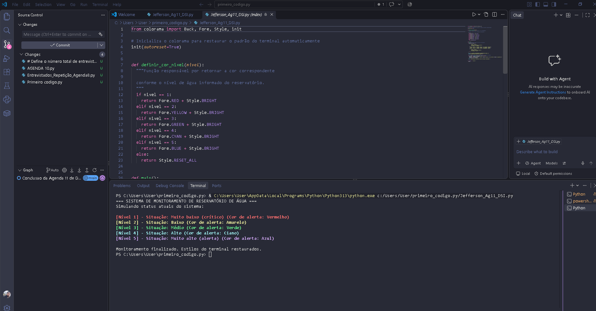

# Sistema de Monitoramento de Níveis de Água (Agenda 11)

Projeto desenvolvido para a disciplina de Desenvolvimento de Sistemas (ETEC), utilizando Python e a biblioteca colorama.

## Resultado da Execução no Terminal

